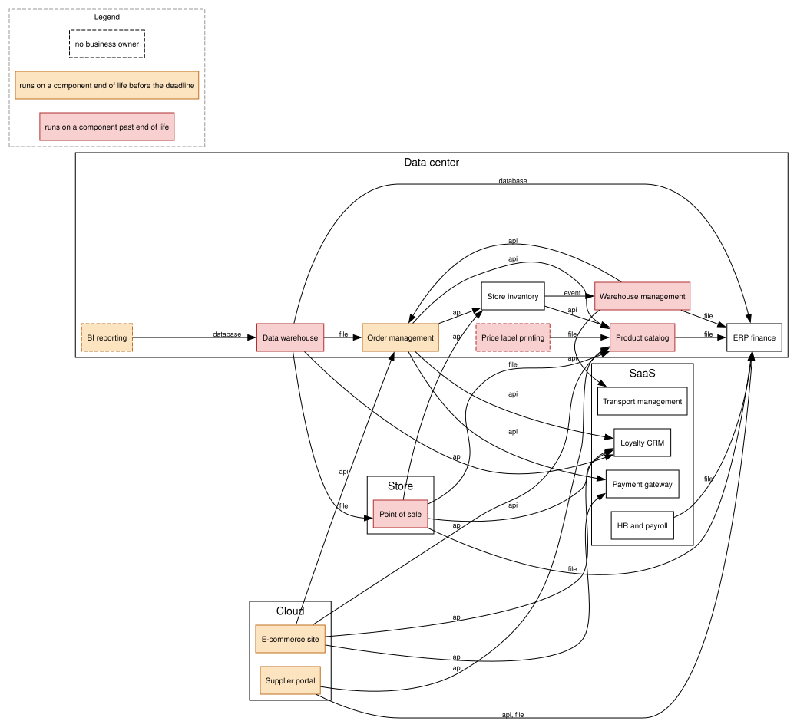

# Application inventory as code

A small tool that keeps an application inventory in Git, checks it automatically and generates dependency maps and an anomaly report from it.

This is a personal learning project. See [Framing and limits](#limits).



*Hosting view of the curated data set as of commit 3d4a32d, rendered on 2026-10-15 with `--reference-date 2026-10-15 --deadline 2028-03-31`. Dashed border: no business owner. Red: runs on a component past end of life. Orange: runs on a component reaching end of life before the deadline. The CI regenerates this map on every push; this file is a dated snapshot.*

## Why

In many IT departments, knowledge about applications is scattered across spreadsheets, diagrams and people's memory. Nobody can reliably say which applications depend on each other, which ones run on end-of-life technologies, or who owns them.

This project treats the inventory like source code: plain text files, reviewed through pull requests, validated on every change.

## Use cases

- **Migration planning:** split a data center exit into waves based on real dependencies.
- **Obsolescence audit:** list applications running on end-of-life technologies.
- **Ownership review:** find applications nobody is accountable for.
- **Onboarding:** give a newcomer an up-to-date map of the landscape.

The demonstration scenario (a fictional fashion retailer leaving its data center) is described in the [scoping note](docs/00-scoping-note.md).

## How it works

1. Each application is described in one YAML file under `inventory/applications/`.
2. A Pydantic schema validates every file.
3. The tool builds a dependency graph and exports it to Mermaid and Graphviz.
4. It generates a Markdown report of anomalies.
5. GitHub Actions runs all of this on every push and fails if the inventory is invalid.

## Getting started

Requirements: git and [uv](https://docs.astral.sh/uv/getting-started/installation/). uv installs the Python version pinned in `.python-version` by itself.

```sh
git clone https://github.com/O-Kemil/archi-as-code.git
cd archi-as-code
uv sync                   # creates .venv with the exact versions of uv.lock
uv run archinv validate   # checks every record under inventory/
uv run archinv report --deadline 2028-03-31   # prints the anomaly report
uv run archinv map --format dot --view hosting --deadline 2028-03-31 --output generated/map-hosting.dot
dot -Tsvg generated/map-hosting.dot -o generated/map-hosting.svg   # optional, needs Graphviz (brew install graphviz)
uv run pytest             # runs the tests
```

`archinv validate` prints `Inventory valid: ...` and exits with status 0, or prints one line per error, with the file and the field, and exits with status 1 (ADR-0004).

Keep the clone outside a synchronised folder such as iCloud Drive. Observed on macOS: files in `.venv` ended up flagged as hidden, and Python 3.13 skips a hidden `.pth` file, so `archinv` could no longer be imported.

## Continuous integration

GitHub Actions runs [`.github/workflows/ci.yml`](.github/workflows/ci.yml) on every push and pull request, every night at 05:17 UTC, and on demand from the Actions tab: `ruff check`, `ruff format --check`, `archinv validate`, `archinv report`, `archinv map` for the global, hosting and end-of-life views in Mermaid and DOT, the DOT files rendered to SVG with Graphviz, then `pytest`. The inventory is validated and the deliverables built before the tests so that an invalid record shows up as a clear error line rather than as a failing test. A step that fails makes the push or the pull request fail. The same commands run locally with `uv run`.

The anomaly report and the hosting map are shown on the page of each run (job summary); everything under `generated/` (report, `.mmd`, `.dot` and `.svg` maps) is attached to the run as the `deliverables` artifact. Nothing under `generated/` is committed (ADR-0006); [`docs/report-example.md`](docs/report-example.md) is a dated snapshot kept for readers of the repository, checked by a test against the curated data set. Graphviz is installed in the CI from apt, the one unpinned installation of the workflow (ADR-0007).

The workflow installs the uv version pinned in the file and the Python version pinned in `.python-version`, then `uv sync --locked`, which fails if `pyproject.toml` changed without `uv.lock` being regenerated.

Third-party actions are pinned by commit SHA, with the release tag in a comment, so that a moved tag cannot change what the CI runs. The runner image is pinned too (`ubuntu-24.04`). Updating them is manual: look up the new release or image, replace the SHA and the comment or the image name. Dependabot can automate the actions part later.

## Repository layout

| Path | Content |
|---|---|
| `inventory/` | The data: applications and IT components |
| `src/archinv/` | The tool: models, graph, report, exporters |
| `docs/adr/` | Architecture decision records |
| `docs/diagrams/` | C4 and ArchiMate views of the tool |
| `generated/` | Report, later the maps, produced by the tool; not committed, the CI produces them (ADR-0006) |

## Decisions

Every structuring decision is recorded as an ADR in [`docs/adr/`](docs/adr/).

- [ADR-0001: Inventory schema for applications and IT components](docs/adr/0001-inventory-schema.md), accepted 2026-10-03.
- [ADR-0002: Tooling for environment, dependencies, tests and lint](docs/adr/0002-tooling.md), accepted 2026-10-05.
- [ADR-0003: Inventory loader and validation errors](docs/adr/0003-inventory-loader.md), accepted 2026-10-08.
- [ADR-0004: Command line interface](docs/adr/0004-command-line.md), accepted 2026-10-09.
- [ADR-0005: Dependency graph model](docs/adr/0005-dependency-graph.md), accepted 2026-10-09.
- [ADR-0006: Anomaly report and generated deliverables](docs/adr/0006-anomaly-report.md), accepted 2026-10-13.
- [ADR-0007: Maps, content, views and formats](docs/adr/0007-maps.md), accepted 2026-10-14.
- [ADR-0008: Archi export, ArchiMate mapping and exchange format](docs/adr/0008-archi-export.md), accepted 2026-10-16.

## Limits

- This is a learning exercise, not a product. It does not compete with commercial enterprise architecture tools.
- It suits teams that already work in Git. Non-technical contributors will not open pull requests.
- Beyond a few dozen contributors, with access rights and approval workflows, a commercial tool is the right choice.
- The sample inventory is fictional. About fifteen applications and their IT components are curated, designed and checked one by one; the others are generated by a script.

## Status

Scoping done. Schema (ADR-0001), tooling (ADR-0002), loader (ADR-0003) and command line (ADR-0004) decided and implemented: `archinv validate` works, 158 tests, CI on every push. The 24 curated records of the Maison Zola data set (15 applications, 9 IT components) are in `inventory/`. The dependency graph (ADR-0005) is built with NetworkX. The anomaly report (ADR-0006) and the maps (ADR-0007: Mermaid and Graphviz, four views) are produced by the CI on every push and every night, 264 tests. Next: the generator of the sample records.
