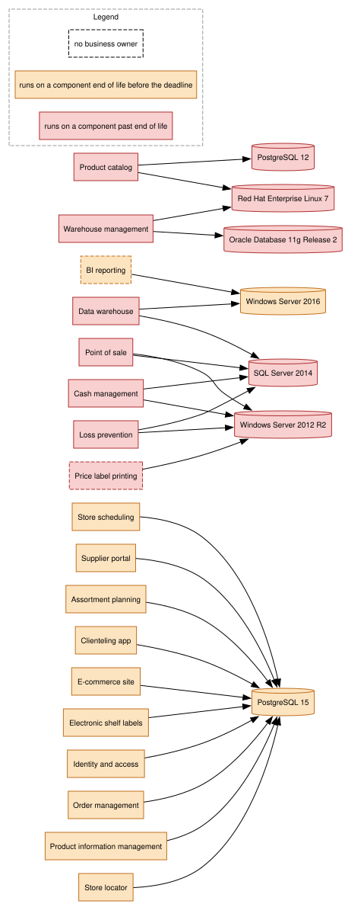

# Application inventory as code


A small tool that keeps an application inventory in Git, checks it automatically and generates dependency maps, an anomaly report and an ArchiMate export from it.

This is a personal learning project. See [Limits](#limits).



*End-of-life view of the complete data set (60 applications, 13 IT components), rendered on 2026-10-16 with `--reference-date 2026-10-16 --deadline 2028-03-31`; the deadline is the end of the hosting contract in the demonstration scenario. Red: component past end of life, and the applications running on it. Orange: component reaching end of life before the deadline. Dashed border: no business owner. The global and hosting maps are in the `deliverables` artifact of each CI run; this file is a dated snapshot.*

## Why

In many IT departments, knowledge about applications is scattered across spreadsheets, diagrams and people's memory. Nobody can reliably say which applications depend on each other, which ones run on end-of-life technologies, or who owns them.

This project treats the inventory like source code: plain text files, reviewed through pull requests, validated on every change.

## Use cases

- **Migration planning:** split a data center exit into waves based on real dependencies.
- **Obsolescence audit:** list applications running on end-of-life technologies.
- **Ownership review:** find applications nobody is accountable for.
- **Onboarding:** give a newcomer an up-to-date map of the landscape.

The demonstration scenario (a fictional fashion retailer, Maison Zola, leaving its data center) is described in the [scoping note](docs/00-scoping-note.md).

## How it works

1. Each application and each IT component is described in one YAML file under `inventory/`. In the sample data set, 15 applications and 13 IT components are curated (written and sourced by hand) and 45 applications are generated by `scripts/generate_sample_inventory.py`, which marks them as generated in their header.
2. A Pydantic schema validates every file: unknown field, wrong value, missing reference or an application depending on itself are errors that name the file and the field.
3. The tool builds a dependency graph with NetworkX and exports it as maps in Mermaid and Graphviz DOT.
4. It generates a Markdown report of anomalies.
5. It exports the inventory as an ArchiMate Open Exchange file that Archi imports without plugin: every application is an Application Component, every IT component a System Software, Device or Technology Service, every link a Serving relationship with the dependency types as a property. The complete data set, exported on 2026-10-16, was imported into an empty model of Archi 5.10.0 without error: 60 Application elements, 13 Technology & Physical elements, 185 relationships.
6. GitHub Actions runs all of this on every push and fails if the inventory is invalid.

### Errors and anomalies

An **error** is a record the schema or the loader rejects (unknown field, malformed date, unknown target, an application depending on itself, two records with the same id). An error fails `archinv validate` with status 1, so it fails the CI. An **anomaly** is a valid record that reveals a problem in the landscape. Anomalies go to the report, and the exit status stays 0, because a record that reveals a problem must be accepted, otherwise the problem would never reach the report. The report detects five kinds of anomalies:

- an application without `business_owner`;
- a circular dependency between applications;
- an IT component past its end of life at the reference date, with the applications running on it;
- an IT component reaching its end of life before a deadline, when `--deadline` is given;
- an application without IT component, outside SaaS applications, which have none by construction.

[`docs/report-example.md`](docs/report-example.md) is a dated example of the report on the complete data set.

## Getting started

Requirements: git and [uv](https://docs.astral.sh/uv/getting-started/installation/). uv installs the Python version pinned in `.python-version` by itself.

```sh
git clone https://github.com/O-Kemil/archi-as-code.git
cd archi-as-code
uv sync                   # creates .venv with the exact versions of uv.lock
uv run archinv validate   # checks every record under inventory/
uv run archinv report --deadline 2028-03-31   # prints the anomaly report
uv run pytest             # runs the tests
```

The first `pytest` downloads the three ArchiMate exchange format XSD files (about 86 KB) from The Open Group into `.cache/archimate-xsd/`, which git ignores, to validate the Archi export. Without network the validation tests are skipped and say how to fetch the files by hand.

### Commands

Every command takes `--inventory PATH` (default: `inventory`). `--reference-date YYYY-MM-DD` defaults to today (UTC). `--output PATH` writes to a file, creating its directory; without it the result goes to standard output. Exit status: 0, or 1 when the inventory is invalid, or 2 on a usage error.

- `archinv validate`: loads every record and every reference; prints `Inventory valid: ...` or one line per error, `file: field: message`.
- `archinv report [--reference-date] [--deadline] [--output]`: the Markdown anomaly report; `--deadline` adds the components reaching end of life before that date.
- `archinv map --format {mermaid,dot} --view {global,hosting,focus,end-of-life} [--focus ID] [--reference-date] [--deadline] [--output]`: one map per call; `focus` needs the id of an application. Render a DOT file with Graphviz: `dot -Tsvg map.dot -o map.svg` (optional, `brew install graphviz`).
- `archinv archi [--reference-date] [--name NAME] [--output]`: the Open Exchange Format file; in Archi, File > Import > Open Exchange XML Model.
- `uv run python scripts/generate_sample_inventory.py`: rewrites the 45 generated records of the sample data set; never edit them by hand.

Keep the clone outside a synchronised folder such as iCloud Drive. Observed on macOS: files in `.venv` ended up flagged as hidden, and Python 3.13 skips a hidden `.pth` file, so `archinv` could no longer be imported.

## Using it on your own inventory

The tool reads any directory with the layout of `inventory/`: an `applications/` folder and an `it-components/` folder, one `.yaml` file per record, the file name equal to the record `id`. To start your own:

1. Copy the two commented templates from `inventory/templates/` and fill one file per application and per IT component. The fields and their rules are in [ADR-0001](docs/adr/0001-inventory-schema.md); applications reference IT components and other applications by id.
2. Run `uv run archinv validate --inventory path/to/your/inventory` until it prints `Inventory valid`. Every error names the file and the field.
3. Run `report`, `map` and `archi` with the same `--inventory`, or replace the content of `inventory/` and let the CI do it: the workflow validates on every push, builds the report, the maps and the Archi export, shows the report and the end-of-life map on the run page and attaches everything to the run.

Three things in this repository belong to the Maison Zola data set and must be removed or adapted: `scripts/generate_sample_inventory.py` with its CI step (it rewrites 45 records into `inventory/applications/`), and `tests/test_dataset.py` (it asserts the anomalies of that data set), as well as the `--deadline 2028-03-31` and `--name` values in the workflow.

## Continuous integration

GitHub Actions runs [`.github/workflows/ci.yml`](.github/workflows/ci.yml) on every push and pull request, every night at 05:17 UTC, and on demand from the Actions tab: `ruff check`, `ruff format --check`, `archinv validate`, a regeneration of the generated records that fails on any diff, `archinv report`, `archinv map` for the global, hosting and end-of-life views in Mermaid and DOT, `archinv archi`, the DOT files rendered to SVG with Graphviz, then `pytest`. The inventory is validated and the deliverables built before the tests so that an invalid record shows up as a clear error line rather than as a failing test. A step that fails makes the push or the pull request fail. The same commands run locally with `uv run`.

The anomaly report and the end-of-life map are shown on the page of each run (job summary); everything under `generated/` (report, `.mmd`, `.dot` and `.svg` maps, Archi export) is attached to the run as the `deliverables` artifact. Nothing under `generated/` is committed; `docs/report-example.md` and `docs/map-end-of-life-example.svg` are dated snapshots kept for readers of the repository, the report one checked by a test against the complete data set. Graphviz is installed in the CI from apt, the one unpinned installation of the workflow.

The workflow installs the uv version pinned in the file and the Python version pinned in `.python-version`, then `uv sync --locked`, which fails if `pyproject.toml` changed without `uv.lock` being regenerated. Third-party actions are pinned by commit SHA, with the release tag in a comment, and the runner image is pinned to `ubuntu-24.04`; updates are manual.

## Repository layout

| Path | Content |
|---|---|
| `inventory/applications/`, `inventory/it-components/` | The data: 60 applications and 13 IT components of the sample data set |
| `inventory/templates/` | Commented templates for the two kinds of record |
| `src/archinv/` | The tool: `models` (Pydantic schema), `loader` (files, references, errors), `graph` (NetworkX), `report` (anomalies, Markdown), `maps` (views, Mermaid, DOT), `archi` (Open Exchange Format), `cli` |
| `scripts/` | `generate_sample_inventory.py`, the generator of the 45 sample applications |
| `tests/` | pytest tests, including `test_dataset.py`, the acceptance test of the sample data set |
| `docs/00-scoping-note.md` | The scenario, the scope of v1 and its success criteria |
| `docs/adr/` | Architecture decision records |
| `docs/releases/` | Release notes |
| `docs/report-example.md`, `docs/map-end-of-life-example.svg` | Dated snapshots of two deliverables |
| `.github/workflows/ci.yml` | The GitHub Actions workflow |
| `generated/` | Produced by the tool and the CI, never committed |

## Decisions

Every structuring decision is recorded as an ADR (architecture decision record: the context, the options, the choice and its cost) in [`docs/adr/`](docs/adr/).

- [ADR-0001: Inventory schema for applications and IT components](docs/adr/0001-inventory-schema.md), accepted 2026-10-03.
- [ADR-0002: Tooling for environment, dependencies, tests and lint](docs/adr/0002-tooling.md), accepted 2026-10-05.
- [ADR-0003: Inventory loader and validation errors](docs/adr/0003-inventory-loader.md), accepted 2026-10-08.
- [ADR-0004: Command line interface](docs/adr/0004-command-line.md), accepted 2026-10-09.
- [ADR-0005: Dependency graph model](docs/adr/0005-dependency-graph.md), accepted 2026-10-09.
- [ADR-0006: Anomaly report and generated deliverables](docs/adr/0006-anomaly-report.md), accepted 2026-10-13.
- [ADR-0007: Maps, content, views and formats](docs/adr/0007-maps.md), accepted 2026-10-14.
- [ADR-0008: Archi export, ArchiMate mapping and exchange format](docs/adr/0008-archi-export.md), accepted 2026-10-16.
- [ADR-0009: Sample data generation](docs/adr/0009-sample-data-generation.md), accepted 2026-10-16.

## Limits

- This is a learning exercise, not a product. It does not compete with commercial enterprise architecture tools.
- It suits teams that already work in Git. Non-technical contributors will not open pull requests.
- Beyond a few dozen contributors, with access rights and approval workflows, a commercial tool is the right choice.
- The sample inventory is fictional: 15 applications and 13 IT components are curated, 45 applications are generated by a script.
- At 60 applications the hosting map is no longer readable: it does not answer the question of the scoping note (what leaves the data center and what it talks to). In v1 that question is covered by the anomaly report and the Archi export; a readable migration map is the first item of v1.1, either a `domain` field with a domain view (schema change) or a hosting view filtered on one box.
- The schema records which application triggers an exchange, not which way the data flows, so every link is exported to Archi as a Serving relationship, never as a Flow.

## Status

Version 1.0.0 meets the five success criteria of the [scoping note](docs/00-scoping-note.md):

1. **60 application records valid against the schema.** `inventory/applications/` holds 60 records (15 curated, 45 generated); `archinv validate` prints `Inventory valid: 60 applications, 13 IT components`; `tests/test_dataset.py` checks the count.
2. **An invalid record makes the CI fail with the file and the field.** Proven on 2026-10-09 by [CI run #3](https://github.com/O-Kemil/archi-as-code/actions/runs/37916382953) on the branch `test/invalid-record`: `broken.yaml` failed the validation step with `business_criticality: Input should be ...`. Covered by the loader and CLI tests.
3. **The map and the report are regenerated with no manual action.** The workflow runs on every push, every night and on demand; the report and the end-of-life map are on the run page and every deliverable is in the `deliverables` artifact.
4. **The report detects the anomalies deliberately placed in the data set.** `tests/test_dataset.py` checks the exact list: three applications without business owner, one cycle, five components past end of life, two reaching it before the deadline, and that there is no application without IT component outside SaaS, the fifth kind of anomaly, none being placed. `docs/report-example.md` shows them.
5. **The export opens in Archi without errors.** The complete data set was imported into an empty model of Archi 5.10.0 on 2026-10-16 without error: 60 Application elements, 13 Technology & Physical elements, 185 relationships; the export is also validated against The Open Group XSD and against Archi's relationship matrix in the tests.

307 tests, run by the CI on every push. The release notes are in [`docs/releases/v1.0.0.md`](docs/releases/v1.0.0.md). Next: v1.1, starting with a readable migration map (see Limits).

## License

MIT, see [`LICENSE`](LICENSE).
